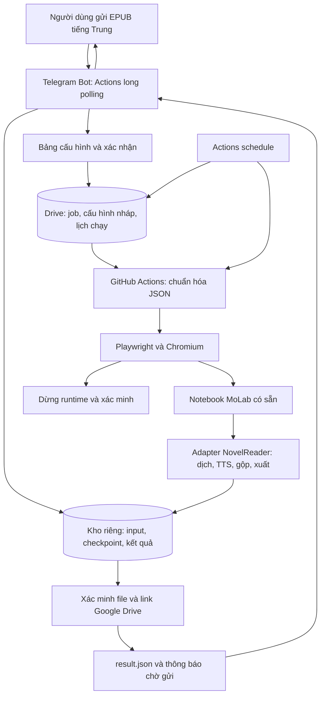

# Kế hoạch triển khai NovelReader Auto Run

Ngày lập: 22/10/2026. Trạng thái: ĐANG TRIỂN KHAI THEO YÊU CẦU MỚI NHẤT. Người dùng đã yêu cầu bắt đầu viết code theo plan. Bản mã đầu tiên gồm bot Telegram, tích hợp Drive, schema, Actions và notebook worker đã được thêm vào workspace; chưa chạy kiểm thử hoặc triển khai lên GitHub/MoLab.

Đầu vào tham khảo: `quy_trinh_v2_tham_khao_NovelReader_Molab.md` và yêu cầu đã chốt Telegram → GitHub Actions → trình duyệt → notebook MoLab mới → dịch/audio → Google Drive → bot trả link.

## 0. Các lựa chọn đã chốt sau trao đổi

Phần này ưu tiên áp dụng nếu khác với đề xuất ban đầu ở các phần sau.

- Repo đã xác định qua Git remote: https://github.com/dungbeommm/NovelReader_Auto_Run.
- Notebook đích người dùng vừa chỉ định: https://molab.marimo.io/notebooks/nb_jto8ABNt6hR63odUKU4UuJ. Tích hợp mã worker vào notebook này là một phần của yêu cầu hiện tại; notebook cũ `NovelReader_Molab` vẫn không được sửa.
- Người dùng xác nhận đã có hình thức sử dụng MoLab phù hợp. Codex được phép khảo sát giao diện và tạo notebook mới `NovelReader_Auto_Run`; người dùng yêu cầu dùng notebook/cell mới, không sửa các cell của notebook `NovelReader_Molab` đã thấy khi khảo sát. “Colab” trong trao đổi trước có nghĩa Codex khảo sát, không phải Google Colab.
- Đầu vào chính là EPUB. Khi triển khai phải khảo sát parser EPUB, thứ tự chương, mục lục và nội dung HTML trong sách.
- Bot hỏi cấu hình ở lần đầu, lưu preset theo Telegram user ID. Những lần gửi truyện sau dùng preset đã lưu; `/config` mở phần chỉnh sửa. Mỗi job chụp một bản cấu hình riêng, sửa preset không đổi job đang chạy. Lần sau vẫn hiện bảng cấu hình và nút Bắt đầu, không hỏi lại từng mục.
- Toàn bộ dữ liệu và kết quả dùng Google Drive API; bot chỉ cần trả link Google Drive. OneDrive đã được bỏ khỏi phạm vi theo lựa chọn mới nhất.
- Ngôn ngữ mặc định: tiếng Trung → tiếng Việt. EPUB là đầu vào chính.
- Bot và scheduler chạy trên GitHub Actions để test trước. Dùng long polling, không yêu cầu webhook public/VPS hoặc DB ngoài trong bản test. Bản test có thể có khoảng gián đoạn khi đổi runner hoặc lịch Actions bị trễ.
- Các lựa chọn định dạng đầu ra, gộp và chia sẻ được đưa vào cấu hình thay vì cố định một phương án.
- Ghi bảng tiến trình từng chương bền vững; khi runner điều khiển dừng, lượt mới đọc bảng và tiếp tục phần còn thiếu. Người dùng muốn chỉ dừng MoLab khi toàn bộ công việc xong. Cần kiểm chứng MoLab tiếp tục chạy và controller mới gắn lại được runtime cũ; nếu runtime bị nền tảng ngắt thì khởi tạo lại và phục hồi từ checkpoint.
- Chỉ báo tiến độ khi người dùng gọi `/status`; vẫn gửi thông báo hoàn thành và log lỗi chủ động. Mọi lỗi chương, TTS, gộp, upload hoặc điều khiển phải có log gửi qua bot, kèm job ID, chương/giai đoạn và chi tiết để sửa. Lọc token/cookie khỏi log.
- Được xóa dữ liệu tạm sau khi hoàn thành: chỉ xóa input/checkpoint/file trung gian khi đầu ra cuối đã được xác minh và bot đã gửi kết quả thành công. Giữ preset, link kết quả và log lỗi phục vụ sửa; không xóa thành phẩm trên cloud.
- Lỗi từng chương: gửi log, ghi trạng thái lỗi rồi tiếp tục chương khác; không tự lặp vô hạn chương đã lỗi. Lỗi toàn cục như hết quyền Drive phải báo log và chờ/retry phục hồi, không giả báo vẫn chạy được.
- Bot token, credential Google Drive và dung lượng EPUB thường dùng vẫn cần khi triển khai chạy thử thật.

## 1. Kết quả cần đạt

Người dùng gửi EPUB tiếng Trung vào Telegram. Bot tải file lên Drive, hỏi cấu hình lần đầu hoặc nạp preset lần sau, hiển thị bảng và nút Bắt đầu. Actions tạo JSON chuẩn, mở notebook automation mới trên MoLab, nạp JSON và EPUB rồi chạy Trung → Việt, audio/gộp theo cấu hình. Kết quả nằm trên Google Drive, bot trả link. Khi Actions kết thúc, lưu state và hẹn lượt sau nối lại runtime còn sống; runtime mất thì mở lại và restore. Khi xong, dừng MoLab và xác minh.

Đích dữ liệu và kết quả duy nhất là Google Drive theo lựa chọn mới nhất. Không cần uploader OneDrive hoặc kho đối tượng ngoài. Bot trả link Google Drive.

## 2. Điều kiện khả thi cần giải quyết trước

1. **MoLab:** trang quy định hiện nêu notebook dùng cho tác vụ không tương tác có thể bị chấm dứt; còn hạn chế proxy và giao diện thay thế editor. Luồng bot tự chạy dài hạn có khả năng thuộc trường hợp này. Cần xác nhận hình thức sử dụng được MoLab cho phép trước khi triển khai nhánh tự động đó. Không chọn tunnel tới NovelReader Web làm đường điều khiển mặc định. [Quy định MoLab](https://molab.marimo.io/pages/molab/restrictions).
2. **Phương án worker:** giữ adapter MoLab; người dùng đã xác nhận hình thức sử dụng phù hợp. Worker khác là phương án dự phòng nếu cần, giữ giao thức Telegram/JSON/checkpoint/Drive.
3. **Notebook thật:** đã khảo sát `NovelReader_Molab`, xem `MOLAB_SURVEY.md`. Người dùng yêu cầu tạo notebook riêng; cần xác minh loader, start/stop và bàn giao runner trên notebook mới.
4. **NovelReader:** danh sách module/model trong tài liệu gốc là đầu mối khảo sát, chưa phải hợp đồng API đã kiểm thử. Đã truy vấn được HEAD công khai `920a1d4464e377d6c03fd53da017f2a00b709b66` bằng `git ls-remote`; API duyệt cây nguồn bị giới hạn truy cập. Khi triển khai phải checkout mã, đọc API thật và pin commit đã kiểm thử.
5. **Telegram:** Bot API công khai hiện giới hạn tải xuống qua `getFile` ở 20 MB. Bot phải báo giới hạn trước khi nhận việc; file lớn hơn dùng đường upload riêng do bot cấp hoặc Local Bot API Server nếu được triển khai. [Telegram Bot API](https://core.telegram.org/bots/api#getfile).

## 3. Kiến trúc được đề xuất



| Thành phần | Nhiệm vụ | Nơi chạy đề xuất |
|---|---|---|
| Bot | Nhận file, hội thoại cấu hình, quyền truy cập, trạng thái | Actions long polling trong giai đoạn test |
| State | Job, lựa chọn, lịch chạy tiếp, thông báo | Snapshot theo phiên bản trên Google Drive |
| Kho job | Truyện gốc, manifest, snapshot và artifact | Google Drive API |
| Scheduler | Quét việc đến hạn, retry, phát hiện runner mất | Workflow Actions schedule |
| GitHub Actions | Tạo JSON chuẩn, điều khiển browser, theo dõi và bàn giao | Ubuntu runner + Chromium/Playwright |
| Notebook worker | Parse truyện, dịch, TTS, gộp, xuất, checkpoint | MoLab khi đáp ứng điều kiện sử dụng |
| Drive uploader | Upload có resume, tạo link, xác minh kết quả | Notebook worker, state bot do bot quản lý riêng |

Trong bản test, bot và scheduler chạy bằng các workflow Actions riêng. Bot dùng `getUpdates` long polling, lưu update offset, preset và bản nháp trên Drive. Chỉ một poller hoạt động qua concurrency group cố định. Trước deadline bot flush state, lưu lịch lượt sau rồi thoát; lượt mới restore offset. Callback/update xử lý lặp không được tạo job trùng. Scheduler schedule quét các lịch đến hạn trên Drive và phục hồi runner chết đột ngột. Không cam kết bot online liên tục; khi đổi runner có thể trả lời chậm. File truyện/audio không đưa vào Git history.

## 4. Hội thoại Telegram và bảng cấu hình đầy đủ

Luồng lần đầu: `/new` hoặc gửi EPUB trực tiếp → tạo bản nháp → tải input lên Google Drive → kiểm tra file → chọn và lưu cấu hình → bảng xác nhận → `[BẮT ĐẦU] [SỬA] [HỦY]`. Lần sau dùng cấu hình đã lưu; `/config` chỉnh preset cho các job tiếp theo.

Bot sinh lựa chọn từ `capabilities.json` gắn với commit NovelReader, không duy trì danh sách model/voice riêng bị lệch khỏi backend. Bảng có chế độ cơ bản/nâng cao; mọi giá trị mặc định cũng xuất hiện trong bản xác nhận.

| Nhóm | Trường cần hỏi/hiển thị | Quy tắc |
|---|---|---|
| Truyện gốc | Tên truyện, file, dung lượng, mã hóa, SHA-256 | Giữ nguyên bản gốc; bản chuyển mã lưu riêng |
| Phạm vi | Ngôn ngữ nguồn/đích, toàn truyện hoặc khoảng chương, cách nhận diện chương | Chỉ cho chọn định dạng/parser đã hỗ trợ |
| Engine chạy | Provider, CPU/GPU, loại tài nguyên nếu có | Phân biệt compute với backend dịch |
| Dịch | Bật/tắt, backend, model, phiên bản model | Kiểm tra model tương thích tài nguyên |
| Tùy chọn dịch | Batch, beam, chunk, chuẩn hóa, phồn→giản, glossary, thay thế từ | Chỉ hiện tham số backend thực sự hỗ trợ |
| TTS | Bật/tắt, Piper/VieNeu hoặc engine có trong catalog | Tắt TTS thì bỏ qua các câu hỏi audio |
| Model giọng | Model TTS, voice ID, phiên bản, nguồn tải | Phân biệt engine, model và voice |
| Tùy chọn audio | Tốc độ, khoảng nghỉ, định dạng, sample rate/bitrate, số worker | Hiện đúng tùy chọn của engine/encoder |
| Pipeline | Dịch đến đâu đọc đến đó, queue size, giới hạn song song | Giới hạn theo RAM/VRAM thực tế |
| Gộp audio | Bật/tắt, số chương mỗi file, tên file, giữ bản từng chương | Gom nhóm theo thứ tự, xử lý cả nhóm cuối |
| Xuất | TXT, EPUB, audio; tên thư mục và quy tắc tên | Audio yêu cầu TTS hoặc audio đầu vào hợp lệ |
| Upload data | Thư mục Drive chứa input/checkpoint, thư mục kết quả | Toàn bộ dữ liệu và link cuối đều Google Drive |
| Link | Quyền truy cập, phạm vi chia sẻ tài khoản cho phép | Không tự mở public nếu chưa chọn |
| Chạy tiếp | Tự resume, thời gian chờ, số lần thử, trần tổng lượt/thời gian | Có lệnh dừng và giới hạn chi phí |
| Dọn dẹp | Giữ input/checkpoint bao lâu, xóa file tạm, dừng runtime khi xong | Chỉ dọn sau khi xác minh dữ liệu |

Các mục không được backend hỗ trợ phải bị ẩn hoặc báo không hỗ trợ, không được âm thầm bỏ qua. Ví dụ tên model/voice trong tài liệu cũ chỉ dùng khi xuất hiện trong catalog đã khảo sát.

Lệnh quản lý: `/config`, `/status`, `/jobs`, `/pause`, `/resume`, `/cancel`, `/result`. Mỗi thao tác kiểm tra Telegram user ID sở hữu job; callback cũ không được sửa cấu hình job đã chạy.

## 5. Gói công việc và JSON

Bot lưu `request.json` là lựa chọn người dùng đã xác nhận cùng phiên bản catalog. Workflow đầu tiên tải request, đối chiếu capability/schema, tạo `config.json` chuẩn và lưu bất biến trên kho job. Các lượt resume tái sử dụng cấu hình này.

```text
jobs/<job_id>/
  request.json
  job.json
  config.json
  input/original.epub
  checkpoints/<generation>/manifest.json
  chapters/translated/...
  audio/chapters/...
  audio/merged/...
  exports/...
  result.json
```

Trong bản test, Google Drive lưu state và lịch theo snapshot có phiên bản; không coi Drive là DB giao dịch hoặc có khóa phân tán. Bot ghi profile/request/update offset; controller ghi lịch/state điều khiển; worker duy nhất ghi bảng chương và checkpoint, không cùng ghi đè một file. Truy cập Drive bằng file ID vì tên có thể trùng. GitHub concurrency ngăn controller trùng trong repo; nếu worker cũ mất liên lạc thì phải xác định nó đã dừng trước khi mở worker thay thế, không chỉ dựa vào file lease trên Drive.

Ví dụ hợp đồng dự kiến dưới đây chỉ minh họa cấu trúc; giá trị backend/model phải được xác minh trước khi chạy:

```json
{
  "schema_version": 1,
  "job_id": "job_20261022_a91f31",
  "source": {
    "novelreader_commit": "<tested_commit>",
    "capabilities_version": "<catalog_hash>"
  },
  "input": {
    "drive_file_id": "<original_epub_file_id>",
    "format": "epub",
    "sha256": "<input_hash>",
    "chapter_range": null
  },
  "compute": {"provider": "molab", "device": "gpu"},
  "translation": {
    "enabled": true,
    "source_language": "zh",
    "target_language": "vi",
    "backend": "ct2",
    "model": "HachimiMT-60-QT",
    "options": {"batch_size": 96, "beam_size": 2}
  },
  "tts": {
    "enabled": true,
    "engine": "piper",
    "voice": "ngochuyennew",
    "options": {},
    "pipeline": {"enabled": true, "queue_size": 2}
  },
  "merge": {"enabled": true, "chapters_per_file": 50},
  "export": {"formats": ["txt", "audio"]},
  "storage": {
    "provider": "gdrive",
    "job_folder_id": "<job_folder_id>",
    "output_folder_id": "<output_folder_id>",
    "sharing": "private"
  },
  "continuation": {
    "enabled": true,
    "delay_minutes": 10,
    "max_attempts": 10,
    "max_total_runtime_hours": 24
  },
  "errors": {"chapter_failure": "log_and_continue", "notify": true},
  "lifecycle": {"keep_runtime_during_controller_handoff": true, "resume_if_runtime_lost": true, "stop_runtime_on_complete": true, "delete_temporary_data_after_success": true}
}
```

`delay_minutes`, `max_attempts`, giới hạn giờ và thông số model là giá trị ví dụ, không phải hạn mức của nhà cung cấp. Schema từ chối trường không biết và tổ hợp sai. Không nhúng token Telegram, cloud, URL chứa token tải file Telegram hay cookie vào JSON/log.

## 6. Điều khiển browser và adapter notebook

1. Workflow nhận job ID cùng thế hệ/lượt chạy, dùng GitHub concurrency và kiểm tra state/runtime trên Drive trước khi lấy quyền điều khiển.
2. Mở Chromium bằng Playwright và truy cập thẳng `MOLAB_NOTEBOOK_URL` đã cấu hình.
3. Khôi phục đăng nhập từ secret nếu còn hợp lệ. Nếu cần MFA/CAPTCHA/đăng nhập lại, chuyển `WAITING_AUTH` và bot báo cần xử lý; không lặp vô hạn.
4. Kiểm tra đúng notebook, phiên bản adapter, tài nguyên và trạng thái runtime. Ghi nhận runtime ID nếu nền tảng cung cấp.
5. Khởi động runtime, chọn GPU nếu được hỗ trợ và yêu cầu. Kiểm tra trạng thái sau từng thao tác.
6. Bản thử nghiệm upload `config.json` và file gốc qua control upload thật. Bản ổn định nạp manifest riêng rồi notebook tự tải file bằng URL ngắn hạn có thể cấp lại.
7. Thêm cell `AUTOMATION JOB LOADER` vào notebook automation mới, không dùng/sửa cell cũ. Cell kiểm tra schema/hash, restore checkpoint, áp cấu hình bằng adapter vào API NovelReader đã khảo sát.
8. Browser bấm đúng nút Run/Start của notebook; cell loader có khóa job để việc Marimo chạy lại cell không tạo pipeline thứ hai.
9. Theo dõi heartbeat/tiến trình bằng state trên Drive; UI dùng cho vòng đời runtime và chẩn đoán. Không cần bấm từng tùy chọn dịch/TTS trên web.
10. Khi cần dừng runtime, dùng control nền tảng thực sự và kiểm tra trạng thái stopped. Đóng tab, dừng cell hoặc kết thúc process chưa đủ chứng minh phiên compute đã dừng.

Selector chỉ được viết sau khi quan sát UI thật, ưu tiên role/label và kiểm tra trạng thái. Khi UI thay đổi, lưu ảnh/trace đã loại dữ liệu nhạy cảm và báo lỗi có thể xử lý; không đoán tọa độ rồi bấm liên tục.

## 7. Pipeline và checkpoint

`Parse chương → chuẩn hóa → dịch → lưu bản dịch → TTS queue → lưu audio → gộp nhóm → xuất → upload → xác minh`.

Tái sử dụng `translation/`, `audio/`, `storage/checkpoints.py`, `workflows/`, `gdrive/` nếu kiểm tra mã xác nhận phù hợp. Viết adapter và đồng bộ checkpoint từ xa bao ngoài engine hiện có.

- Mỗi chương có ID ổn định, trạng thái riêng cho dịch/TTS/upload, checksum, URI và fingerprint cấu hình. Không chỉ lưu số chương cuối vì có thể có khoảng trống do chạy song song.
- Mỗi nhóm gộp có danh sách chương theo thứ tự và fingerprint đầu vào để biết khi nào cần gộp lại.
- Upload artifact hoàn chỉnh trước, sau đó publish manifest thế hệ mới. Restore chỉ đọc snapshot đã commit; file tạm không được coi là hoàn thành.
- Snapshot DB local phải nhất quán, không copy file SQLite đang ghi tùy tiện. Dùng cơ chế backup/export được backend hỗ trợ.
- Checkpoint sau từng đơn vị hoàn tất, đồng bộ theo lô ngắn để giảm overhead và flush toàn bộ trước khi bàn giao. Phần chưa đồng bộ có thể cần chạy lại khi máy chết.
- Đổi controller không được tự làm worker MoLab còn khỏe mất quyền xử lý. Worker cũ chỉ mất quyền khi được thay thế thực sự; chỉ file lease trên Drive không đủ chứng minh khóa phân tán. Cần xác minh runtime cũ đã dừng hoặc có cơ chế ngăn nó ghi trước khi mở worker mới.
- Lỗi từng chương được log rồi tiếp tục chương khác. TTS không đọc bản dịch hỏng; gộp audio phải báo rõ danh sách chương thiếu. Kết thúc có lỗi dùng `COMPLETED_WITH_ERRORS`, không báo thành công toàn bộ. Giữ dữ liệu tối thiểu và context của chương lỗi để sửa, dù phần tạm thành công được phép dọn.
- Thay input/model/voice/tùy chọn tạo job mới hoặc version mới; chỉ tái sử dụng artifact có fingerprint tương thích.

## 8. Hết thời gian Actions và hẹn chạy tiếp

GitHub-hosted job có giới hạn hiện tại 6 giờ. Đề xuất bắt đầu bàn giao sau 5 giờ 20 phút; dành phần còn lại cho flush, upload và đóng phiên, với timeout workflow rõ ràng. Đây là mốc vận hành đề xuất, không phải bảo đảm thời gian MoLab. [Giới hạn GitHub Actions](https://docs.github.com/en/actions/reference/limits).

**Phương án phục hồi khi phải dừng runtime (không phải hành vi ưu tiên người dùng đã chọn):**

1. Controller yêu cầu notebook ngừng nhận chương mới và hoàn tất/lưu công việc đang chạy trong thời hạn cho phép.
2. Notebook đồng bộ checkpoint ra kho bền vững, xác nhận generation đã lưu.
3. Ghi giao dịch trạng thái `PAUSED`, `resume_after`, thế hệ checkpoint và lý do. Lịch tồn tại trước khi runner kết thúc.
4. Dừng phiên MoLab, xác minh; nếu chưa xác minh được thì đánh dấu cleanup pending để scheduler thử lại.
5. Workflow Actions schedule đến hạn sẽ dispatch lượt mới. Runner mới tải checkpoint, mở notebook và tiếp tục các đơn vị còn thiếu; chương lỗi đã được bỏ qua không tự lặp vô hạn.

**Hành vi ưu tiên theo lựa chọn người dùng:** giữ MoLab chạy trong lúc đổi controller, chỉ dừng khi hoàn tất toàn bộ công việc. Chế độ này cần xác minh nền tảng cho phép runtime tồn tại độc lập và có thể gắn lại đúng runtime. Trước khi Actions kết thúc, lưu bảng chương/checkpoint, runtime ID và lịch tiếp theo vào kho bền vững. Controller mới phải bắt lại phiên đang chạy trước khi cân nhắc tạo phiên mới; tránh hai worker cùng xử lý một job. Nếu runtime còn chạy, không khởi động lại pipeline; nếu runtime đã mất, restore checkpoint. Nếu nền tảng không cho phép giữ phiên qua lần đổi controller, cần trao đổi lại lựa chọn này.

**Khi runner chết đột ngột:** heartbeat/lease hết hạn → scheduler xác định trạng thái runtime cũ → yêu cầu dừng hoặc rào quyền ghi → tìm checkpoint remote cuối đã commit → tạo lượt phục hồi. Không phụ thuộc `finally` của runner cũ.

`resume_after` lưu UTC, bot hiển thị giờ Việt Nam `Asia/Ho_Chi_Minh`. Không dùng `sleep` dài để giữ runner chờ lịch.

Có thể thêm workflow cron làm lớp phục hồi dự phòng. Cron Actions có thể trễ hoặc bị bỏ lượt, nên không hứa chạy chính xác từng phút. [Sự kiện schedule](https://docs.github.com/en/actions/reference/workflows-and-actions/events-that-trigger-workflows#schedule).

Retry dùng backoff, phân biệt lỗi mạng với lỗi cấu hình/đăng nhập/hết quota. Khi chạm trần lượt, tổng giờ hoặc ngân sách, dừng tự chạy và gửi trạng thái cùng checkpoint. Không tự khởi động lại để vượt hạn mức dịch vụ.

## 9. Google Drive, result, log và dừng phiên

1. Export, upload Drive và kiểm tra artifact theo cấu hình. File lớn dùng upload có resume, lưu mapping artifact → Drive file ID để retry không tạo bản sao.
2. Xác minh số file, kích thước/checksum khi hỗ trợ; tạo link riêng hoặc chia sẻ theo lựa chọn người dùng. Không tự mở công khai.
3. Lưu `result.json` và outbox trên Drive. Bot gửi link thư mục Google Drive, thống kê chương thành công/lỗi và TXT/EPUB/audio đã tạo.
4. Lỗi từng chương gửi log rồi tiếp tục. Log gồm job ID, chapter ID, giai đoạn, thời điểm và traceback đã lọc token/cookie. Có thể gộp thông báo lỗi lặp kèm file log đầy đủ; không bỏ mất sự kiện. Không gửi tiến độ định kỳ.
5. Khi đã đi hết công việc và dữ liệu bền vững, dừng MoLab, xác minh và ghi `runtime_status=stopped`. Nếu có chương lỗi thì kết quả `COMPLETED_WITH_ERRORS` kèm danh sách lỗi, không báo hoàn chỉnh toàn truyện.
6. Nếu chưa xác minh stop, ghi `cleanup_pending` và thử lại cleanup riêng. Không chạy lại dịch/TTS.
7. Chỉ xóa input/checkpoint/file tạm khi kết quả đã xác minh, runtime dừng và bot gửi link thành công. Giữ preset, kết quả, log và dữ liệu cần sửa chương lỗi.

Nếu Drive lỗi, chuyển `WAITING_FINAL_UPLOAD`, giữ dữ liệu có thể phục hồi và chỉ retry upload. Lỗi hạ tầng toàn cục không bị coi như chương lỗi có thể bỏ qua.

`result.json` gồm job ID, trạng thái, thống kê chương, Drive file ID/link, lỗi còn tồn tại và trạng thái runtime. Outbox có ID ổn định; khi Telegram lỗi vẫn giữ result để gửi lại hoặc `/result` truy xuất. Không hứa exactly-once khi API gửi tin bị timeout.

## 10. Trạng thái và kiểm soát đồng thời

Luồng chính: `DRAFT → CONFIGURED → QUEUED → PREPARING → STARTING_WORKER → RUNNING → EXPORTING → UPLOADING → RESULT_READY → COMPLETED`.

- Tạm dừng: `RUNNING → CHECKPOINTING → PAUSED → QUEUED`.
- Ngoại lệ: `WAITING_AUTH`, `WAITING_FINAL_UPLOAD`, `FAILED_RETRYABLE`, `FAILED_FINAL`, `CANCELLED`.
- `phase` mô tả dịch/TTS/gộp; `runtime_status` và `cleanup_status` lưu riêng để không làm mất thông tin kết quả.
- `COMPLETED` yêu cầu kết quả Drive đã xác minh và runtime đã dừng; `COMPLETED_WITH_ERRORS` ghi rõ chương lỗi sau khi phần còn lại đã xử lý xong.
- Dùng concurrency trong GitHub và quyền ghi state tách biệt; việc thay worker phải xác minh trạng thái runtime cũ. Không giả định Drive có DB lease giao dịch.
- `/cancel` hủy lịch tương lai, ngừng nhận việc, lưu phần đã hoàn thành, dừng runtime. Không tự resume một job đã hủy.

## 11. Các giai đoạn triển khai và tiêu chí nghiệm thu

| Giai đoạn | Công việc | Tiêu chí hoàn thành |
|---|---|---|
| P0 — Khảo sát | Checkout NovelReader, đọc API/catalog, khảo sát notebook thật, điều kiện MoLab, đăng nhập và nút stop | Chốt backend khả thi, commit và cách start/stop đã chứng minh |
| P1 — Hợp đồng | Schema request/config/state/result, catalog, adapter, state Drive | Cấu hình sai bị từ chối; input/hash và version truy được |
| P2 — Bot | Nhận truyện, upload, wizard, bảng đủ trường, sửa/xác nhận, quyền chủ job | Restart bot vẫn giữ bản nháp; bấm bắt đầu lặp không tạo job trùng |
| P3 — Adapter | Nạp JSON + input, parse/dịch, TTS, gộp, export, checkpoint remote | Truyện mẫu vài chương tạo đúng đầu ra; resume không xử lý lại phần đã xác minh |
| P4 — Browser/Actions | Workflow tạo JSON, mở notebook cố định, upload/load, run, monitor, stop | Tự hoàn thành một job nhỏ và xác minh runtime stopped |
| P5 — Drive | OAuth, upload resume, link, outbox Telegram | Có link Drive mở được bằng đúng quyền đã chọn |
| P6 — Chạy tiếp | Actions schedule, concurrency, deadline, lỗi bất ngờ, cleanup retry | Cắt runner giữa chừng vẫn phục hồi; không tạo worker trùng |
| P7 — Vận hành | Secret, quota, cảnh báo, retention, hướng dẫn cài đặt và phục hồi | Chạy end-to-end, kiểm tra dừng/hủy/hết quota và tài liệu bàn giao |

Kiểm thử tập trung vào: schema/catalog; EPUB gốc; resume có khoảng trống; chương lỗi gửi log rồi tiếp tục; gộp nhóm cuối; upload không nhân bản; bot offset/preset sau restart; runner bị kill; runtime mất; cookie hết hạn; Drive hết dung lượng; stop thất bại. Dùng timeout ngắn để test bàn giao.

## 12. Cấu trúc mã dự kiến

```text
bot/                  # long polling, wizard, menu, command, notifier
orchestrator/         # job, lease, scheduler, outbox, github_dispatch
browser/              # molab controller, login state, selectors, monitor
adapters/             # NovelReader adapter và worker interface
notebook/             # loader/wrapper của notebook đã có
storage/              # Google Drive state, remote checkpoint, outbox
schemas/              # request, config, state, result, capability
tests/                # contract, resume, upload và smoke end-to-end
.github/workflows/    # prepare/run job, recovery scan, cleanup
```

Không copy toàn bộ NovelReader sang project mới. Pin dependency hoặc checkout commit trong bước build; mapping cấu hình và khả năng resume phải có kiểm chứng với commit đó.

## 13. Thông tin cần có khi bắt đầu triển khai

- Repo GitHub đích, nhánh và quyền kích hoạt workflow; dùng GitHub App hoặc token có phạm vi cần thiết. Workflow tạo tiếp phải cấu hình token/event hợp lệ, không giả định mọi sự kiện dùng `GITHUB_TOKEN` đều sinh lượt mới.
- URL notebook sau khi Codex tạo, cơ chế đăng nhập và truy cập từ cloud runner, loại tài nguyên/quota.
- Telegram bot token và Telegram user ID được phép; bot/scheduler đã chốt chạy Actions để test.
- Google Drive API credential và thư mục gốc. Lưu secret trực tiếp, không commit hoặc ghi log. Chọn cách cấp quyền notebook mà không nhúng bí mật vào file chia sẻ.
- EPUB mẫu ngắn, dung lượng EPUB lớn nhất thường dùng và model/voice do người dùng chọn qua wizard lần đầu.
- Các tùy chọn dịch/audio thực sự cần dùng, model/voice mong muốn và một truyện mẫu ngắn để nghiệm thu.

Các thông tin này là đầu vào triển khai, không ngăn việc hoàn thành bản kế hoạch hiện tại.

## 14. Tiến độ triển khai và công việc tiếp theo

**Đã có trong workspace:** package `app` nhận EPUB, lưu manifest/preset/job lên Google Drive, xác nhận Bắt đầu và dispatch GitHub; schema cấu hình/job; workflow poller Telegram 5 phút/lượt; notebook worker dùng SQLite checkpoint, tiếp tục các chương còn thiếu và upload artifact; README hướng dẫn secrets. Notebook MoLab đang hoạt động chưa được sửa trong bước này.

**Còn phải hoàn thiện trước khi gọi là end-to-end:**

1. Kết nối mã notebook mới này vào notebook MoLab đã tạo; cần truy cập UI/phiên MoLab để nhập hoặc import file.
2. Xác minh API NovelReader đã pin và hoàn thiện ánh xạ model/voice/tùy chọn theo catalog thực tế.
3. Tự khởi chạy/đánh thức notebook từ GitHub Actions, điều khiển phiên MoLab, chống worker trùng và dừng runtime khi xong. Workflow dispatch hiện mới xác thực/nhận job; notebook cần được khởi chạy thủ công và giữ hoạt động.
4. Cấp Drive OAuth an toàn cho cả Actions và MoLab; chạy một EPUB mẫu để xác minh checkpoint, lỗi từng chương, gộp audio, xuất file và link quyền riêng tư.
5. Chỉ sau khi các bước trên được chứng minh mới bật cleanup cuối job hoặc xem là hoàn thành triển khai.

Điều kiện còn chưa chứng minh: đăng nhập/điều khiển UI từ runner cloud; giữ runtime qua đổi controller; dừng toàn bộ compute; cấp credential Drive cho notebook; xử lý giới hạn kích thước; tương thích đầy đủ model/voice và định dạng EPUB thực tế. Các mục này là phần việc kỹ thuật còn lại, không thay đổi các lựa chọn người dùng đã chốt.
